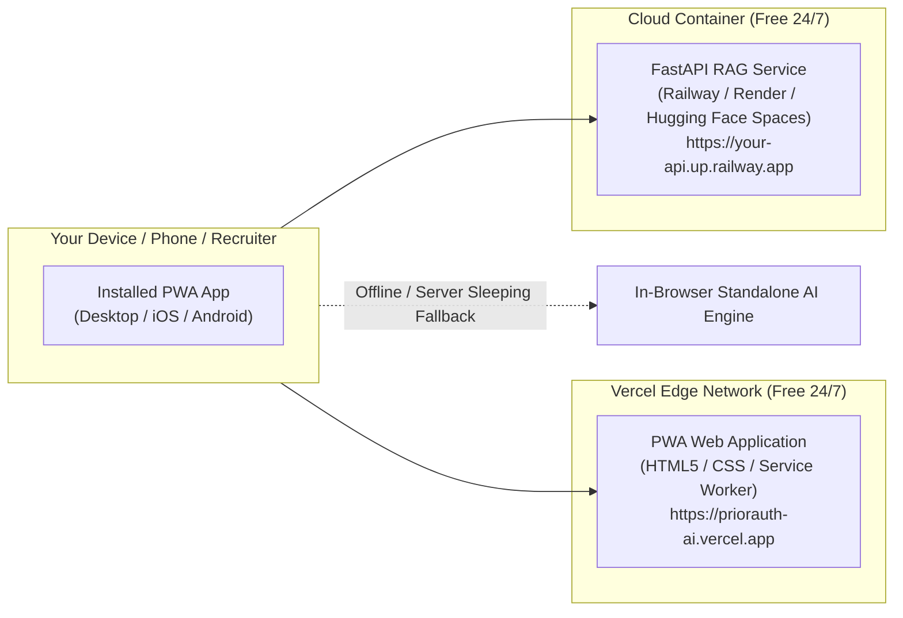

# 24/7 Cloud Deployment Guide: Run Without Your Laptop

This guide explains how to host both the **Standalone Progressive Web App (PWA)** and the **FastAPI RAG Backend** completely in the cloud for free, so it runs **24/7 even when your laptop is completely turned off**.

---

## Architecture Overview



---

## Step 1: Deploy the PWA Frontend to Vercel (2 Minutes)

The `pwa/` folder is a complete, production-ready Progressive Web App with service worker, app manifest, and icons.

### Option A: Using the Vercel CLI
```powershell
cd pwa
npx vercel --prod
```

### Option B: Using GitHub on Vercel.com
1. Push your repository to GitHub.
2. Go to [vercel.com](https://vercel.com) and click **"Add New Project"**.
3. Import your GitHub repository.
4. Set the **Root Directory** to `pwa`.
5. Click **Deploy**.

**Result**: You get an instant live HTTPS link (e.g. `https://priorauth-ai.vercel.app`).
* Anyone opening this link on Chrome, Edge, Safari, or Android will see an **"Install App"** prompt.
* Clicking install puts a native desktop/mobile application icon on their device.
* **It never shuts off or sleeps.**

---

## Step 2: Deploy the FastAPI Backend (24/7 Cloud Host)

To have the deep Python RAG models (Qdrant, BGE embeddings, BM25, Cross-Encoder) running 24/7 without your laptop:

### Option A: Hugging Face Spaces (Recommended — 100% Free 2 vCPU / 16GB RAM)
1. Go to [huggingface.co/spaces](https://huggingface.co/spaces) and click **"Create new Space"**.
2. Name it `healthcare-prior-auth-rag`.
3. Choose **Docker** as the SDK (Blank template).
4. Connect or push this repository.
5. Hugging Face will automatically build using your `Dockerfile` and expose port `8000`.
6. Your backend URL will be: `https://<your-username>-healthcare-prior-auth-rag.hf.space`.

### Option B: Railway.app (1-Click Docker Deployment)
1. Go to [railway.app](https://railway.app).
2. Click **New Project** -> **Deploy from GitHub repo**.
3. Railway automatically detects `Dockerfile` and deploys your service.
4. Go to **Settings** -> **Generate Domain** to get your public URL (e.g., `https://prior-auth-rag.up.railway.app`).

### Option C: Render.com
1. Go to [render.com](https://render.com).
2. Click **New** -> **Web Service** -> Connect GitHub repo.
3. Select **Docker** environment.
4. Expose port `8000`.

---

## Step 3: Link Your PWA to Your Cloud Backend

1. Open your live Vercel PWA link on your phone or computer.
2. Click the **"⚙️ Cloud API"** button in the top navigation bar.
3. Paste your cloud backend URL (e.g. `https://your-api.up.railway.app` or `https://your-space.hf.space`).
4. Done! The PWA will now send live prior auth requests directly to your cloud AI container.

---

## Step 4: The In-Browser Standalone Safety Net

Even if:
- Your cloud container is spinning up from cold boot
- The user is completely offline on an airplane
- No backend server is configured

The PWA has an **embedded In-Browser Clinical Decision Engine** built directly into `pwa/app.js`. Selecting **"Client-Side Engine"** verifies criteria, checks conservative trials, detects contraindications, quotes evidence, and generates determination checklists **100% inside the browser with zero server calls**.
